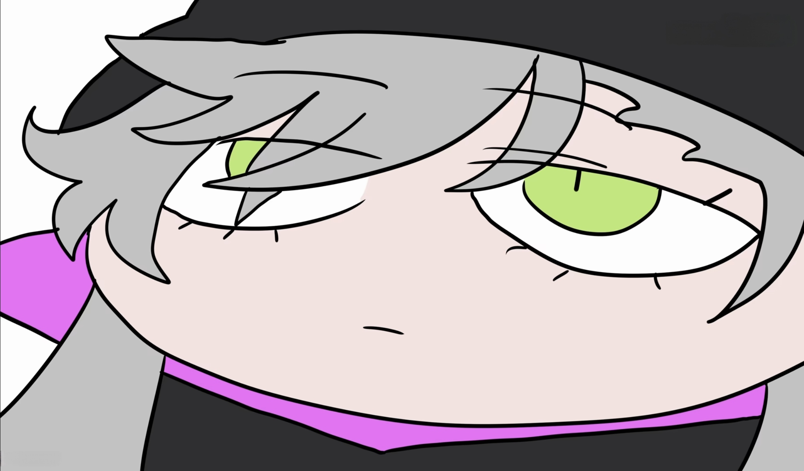
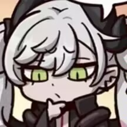
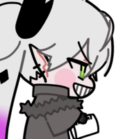
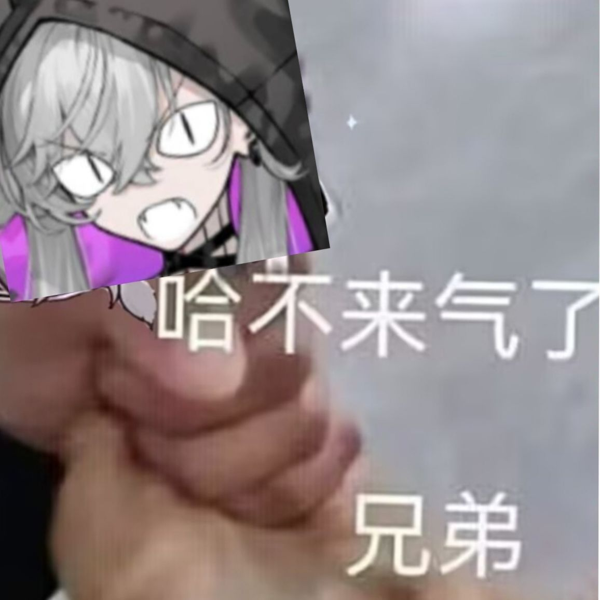
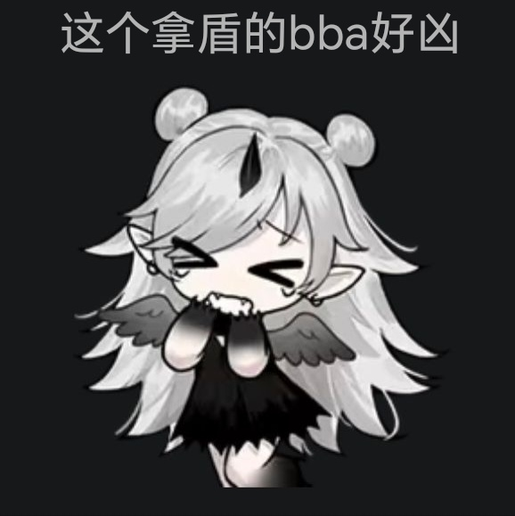
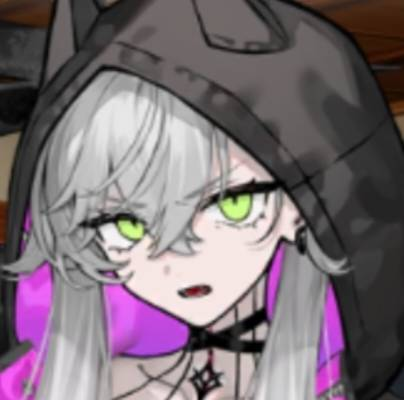
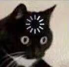
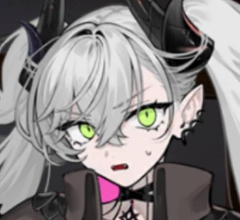
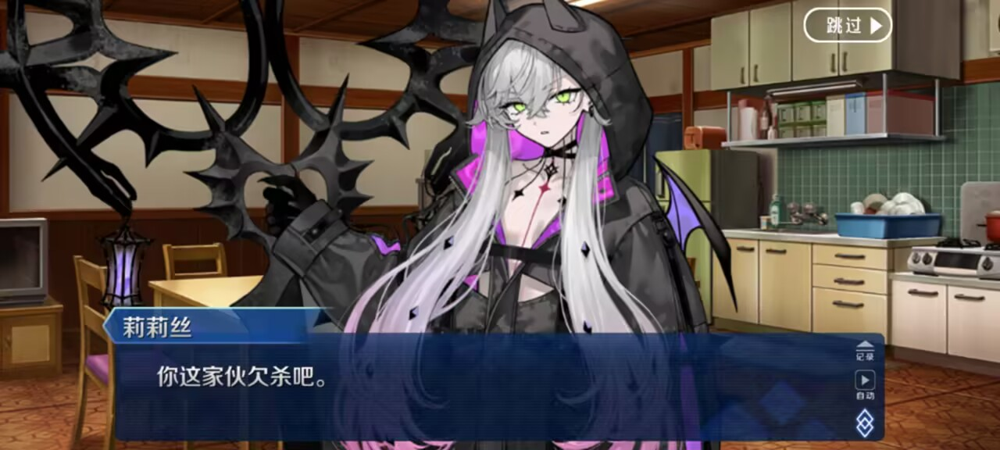

# emoji-pack · 表情包

> 25 张自用表情包，已整理成 **meme_manager 表情包格式**：`manifest.json` + `memes/<分类>/`。

## 仓库结构

```
emoji-pack/
├── packs/
│   └── emoji-pack/            ← 表情包根目录（GitHub 子路径填这个）
│       ├── manifest.json      # 包 ID、名称、9 个分类
│       ├── memes/             # 分类目录
│       └── previews/cover.jpg # 封面
└── README.md
```

## 装进 meme_manager

| 字段 | 值 |
| --- | --- |
| 仓库 | `Tlaloc-yo/emoji-pack` |
| 分支 | `main` |
| 子路径 | `packs/emoji-pack` |

等价的 source 描述：

```json
{"type": "github", "repo": "Tlaloc-yo/emoji-pack", "ref": "main", "subpath": "packs/emoji-pack"}
```

## 直接引用单张图

```markdown

```

## 分类清单

| 分类 | 说明 | 张数 |
| --- | --- | --- |
| `speechless` | 无语 / 冷漠 / 面无表情 / 看穿一切 | 5 |
| `confused` | 疑惑 / 思考 / 没听懂 | 2 |
| `happy` | 开心 / 兴奋 / 打招呼 | 4 |
| `angry` | 生气 / 抱怨 / 凶人 | 3 |
| `shocked` | 震惊 / 吓到 / 意外 | 2 |
| `cute` | 可爱 / 卖萌 / 探头 | 4 |
| `nervous` | 紧张 / 出汗 / 心虚 | 1 |
| `smug` | 得意 / 坏笑 / 挑衅 | 1 |
| `other` | 其他 / 杂项 | 3 |

## 全部图片

### speechless · 无语 / 冷漠 / 面无表情 / 看穿一切

| 预览 | 文件名 | 尺寸 | 大小 |
| --- | --- | --- | --- |
|  | `侧目.png` | 431x281 | 176 KB |
|  | `兜帽凝视.jpg` | 344x376 | 15 KB |
|  | `冷漠特写.jpg` | 2168x1272 | 269 KB |
|  | `微笑省略号.jpg` | 730x590 | 110 KB |
|  | `无语.jpg` | 1920x1904 | 402 KB |

### confused · 疑惑 / 思考 / 没听懂

| 预览 | 文件名 | 尺寸 | 大小 |
| --- | --- | --- | --- |
|  | `思考.jpg` | 216x216 | 15 KB |
|  | `诶.jpg` | 556x392 | 31 KB |

### happy · 开心 / 兴奋 / 打招呼

| 预览 | 文件名 | 尺寸 | 大小 |
| --- | --- | --- | --- |
|  | `chibi-笑.gif` | 200x200 | 32 KB |
|  | `忠诚敬礼.png` | 200x187 | 67 KB |
|  | `激动.jpg` | 316x278 | 33 KB |
|  | `眨眼.png` | 397x251 | 168 KB |

### angry · 生气 / 抱怨 / 凶人

| 预览 | 文件名 | 尺寸 | 大小 |
| --- | --- | --- | --- |
|  | `哈不来气了.jpg` | 1156x1156 | 76 KB |
|  | `拿盾的bba好凶.jpg` | 578x579 | 62 KB |
|  | `指指点点.jpg` | 342x260 | 31 KB |

### shocked · 震惊 / 吓到 / 意外

| 预览 | 文件名 | 尺寸 | 大小 |
| --- | --- | --- | --- |
|  | `惊愕.jpg` | 404x400 | 17 KB |
|  | `震惊.jpg` | 360x380 | 16 KB |

### cute · 可爱 / 卖萌 / 探头

| 预览 | 文件名 | 尺寸 | 大小 |
| --- | --- | --- | --- |
|  | `chibi-小恶魔.gif` | 240x240 | 1.53 MB |
|  | `探头.jpg` | 204x208 | 16 KB |
|  | `星星眼猫猫.jpg` | 140x136 | 3 KB |
|  | `猫耳兜帽.jpg` | 1280x1244 | 122 KB |

### nervous · 紧张 / 出汗 / 心虚

| 预览 | 文件名 | 尺寸 | 大小 |
| --- | --- | --- | --- |
|  | `紧张特写.jpg` | 492x452 | 23 KB |

### smug · 得意 / 坏笑 / 挑衅

| 预览 | 文件名 | 尺寸 | 大小 |
| --- | --- | --- | --- |
|  | `坏笑.jpg` | 112x136 | 5 KB |

### other · 其他 / 杂项

| 预览 | 文件名 | 尺寸 | 大小 |
| --- | --- | --- | --- |
|  | `剧情截图.jpg` | 1280x576 | 134 KB |
|  | `绿眼特写.gif` | 400x224 | 1.42 MB |
|  | `说话.jpg` | 250x250 | 24 KB |

## 说明

- 图片内容未做任何修改（未压缩、未转格式），只按聊天语义归类并改了文件名。
- 素材版权归原作者，仅个人使用。
